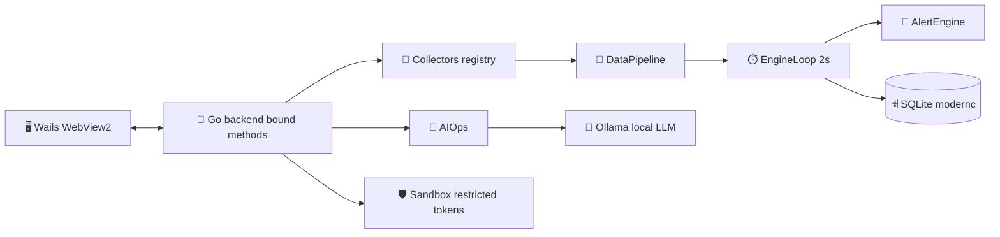

# Winops 🖥️ — Local-First Windows Operations Dashboard

> **SysOps, NetOps, SecOps, DevOps, and AIOps in one native Windows desktop
> app** — with Ollama-powered local AI. All analysis runs on your machine. No
> telemetry. No cloud accounts required. 🛡️

[](https://github.com/shahriarhaqueabir/Winops/actions/workflows/ci.yml)
[](LICENSE)
[](https://www.microsoft.com/windows)
[](https://go.dev)
[](https://wails.io)
[](https://react.dev)
[](https://ollama.com)

---

## 🎬 The story — why this exists

Modern IT ops tooling is fragmented and cloud-dependent: Task Manager,
PowerShell, `netsh`, Wireshark, Docker Desktop, kubectl, Defender consoles, and
a browser full of SaaS dashboards — each phoning home, each with its own auth.
At 2 AM on an air-gapped network you need answers _now_, not a login screen.
Winops collapses that stack into a single native Windows desktop app
running entirely offline: hardware/process telemetry, network diagnostics,
security posture, container/K8s management, and a local AI analyst. Nothing
leaves the machine. 🌙

> 💡 **The one sentence that drove everything:** _One pane of glass for a
> Windows host, with no cloud dependency._

---

## 🔁 The feedback loop (zero → finished)

```
  1. 📥 COLLECT    collectors probe OS on intervals → DataPipeline
  2. 📊 METRICS    EngineLoop (2s tick) emits live metrics to frontend
  3. 🚨 ALERTS     AlertEngine evaluates rules, persists, debounces flaps
  4. 🤖 AI         AIOps builds grounded prompt from live context → LLM
  5. ✅ CONFIRM    AI-suggested remediations require explicit user OK
  6. 📓 AUDIT      forensics, decisions, logs stored locally (SQLite)
  7. 🔁 REPEAT     next tick, next incident
```

> 🧠 **Secret of the loop:** AI never acts without confirmation. Every
> remediation is a proposal gated by a safety handshake and audited in
> `decisions_audit`.

---

## 🏗️ Architecture — how the pieces talk



| Component      | Responsibility                        | Key location                  |
| -------------- | ------------------------------------- | ----------------------------- |
| 🖥️ Frontend    | React 19 + TS, dashboards, charts     | `cmd/winops-gui/frontend/`    |
| 🐹 Backend     | Go 1.26, collectors, engine, alerts   | `internal/`                   |
| 📡 Collectors  | OS probing → MetricSample             | `internal/common/`            |
| 🚨 AlertEngine | Rules, flapping debounce, persistence | `internal/common/alerts.go`   |
| 🤖 AIOps       | Grounded prompts, streaming LLM       | `internal/aiops/`             |
| 🗄️ Database    | SQLite (modernc, pure Go, WAL)        | `data/winops.db`        |
| 🛡️ Sandbox     | Restricted tokens, low integrity      | `internal/common/sandbox*.go` |

---

## 🏆 Good choices (and why they were good)

1. **🏠 No telemetry, ever.** No analytics, crash reporting, or phone-home.
   Only optional user-initiated update check.
2. **🐹 Pure-Go SQLite** (`modernc.org/sqlite`). No CGO, reproducible builds,
   WAL mode for concurrent reads.
3. **📦 Removed the Ollama SDK.** Direct HTTP client = smaller attack surface,
   fewer transitive deps.
4. **🎯 Windows-only target.** Dropped Linux/macOS paths to keep the
   codebase focused and auditable.
5. **🛡️ Safety handshake.** AI-suggested remediations require explicit
   confirmation and are audited.
6. **⚡ Wails v2 over Electron.** Native window, Go bindings, ~36 MB binary.

---

## 📋 The playbook — recreate from zero

### Phase 0 — Scope 🎯

1. One sentence: _"One pane of glass for a Windows host, no cloud."_
2. Boundaries: local-first, no telemetry, least privilege, auditable.

### Phase 1 — Skeleton 🦴

3. Wails v2 + Go 1.26 + React 19 + TS + Vite + Tailwind 4.
4. Pure-Go SQLite (modernc), WAL mode.
5. Collector registry pattern.

### Phase 2 — Data pipeline 📊

6. Collectors probe OS on intervals → DataPipeline.
7. EngineLoop 2s tick emits live metrics.
8. AlertEngine with default + user rules, flap debouncing.
9. Retention pruning (default 7 days).

### Phase 3 — Modules 🧩

10. SysOps: CPU/mem/disk/GPU, processes, services, logs, diagnostics.
11. NetOps: interfaces, routing, DNS, ARP, Wi-Fi, port scan, topology.
12. SecOps: posture score, firewall, Defender, hardening, forensics, IR.
13. DevOps: Docker, K8s, packages, scripts/workflows.
14. AIOps: local AI chat with live context, reports, tool workflows.

### Phase 4 — AI integration 🤖

15. Grounded prompts from knowledge snapshot + metric history + events.
16. Stream tokens from local LLM (Ollama or in-process go-llama).
17. `<action_request>` tags gated by safety handshake.

### Phase 5 — Security hardening 🛡️

18. Sandbox: restricted tokens, dropped privileges, low integrity.
19. Input validation: PIDs, IPs, usernames, service/interface/k8s names.
20. `ScrubSecrets` redacts passwords/keys/tokens from persisted events.

### Phase 6 — Ship 🚢

21. `wails build` → `build/bin/Winops.exe`.
22. Go tests + frontend build. Release on GitHub.

---

## ⚠️ Mistakes to avoid

- 🚫 **Telemetry.** No analytics, crash reporting, or phone-home. Ever.
- 🚫 **CGO dependencies.** Pure-Go SQLite keeps builds reproducible.
- 🚫 **Heavy SDKs.** Direct HTTP client over Ollama SDK = smaller attack surface.
- 🚫 **Cross-platform sprawl.** Windows-only keeps it focused and auditable.
- 🚫 **Ungated remediation.** AI proposes; human confirms; audit logs it.
- 🚫 **Trusting user input in exec.** Validate PIDs, IPs, names before exec.

---

## 🧰 Stack

| Layer            | Choice                       | Why                                 |
| ---------------- | ---------------------------- | ----------------------------------- |
| 🖥️ Desktop shell | Wails v2 (WebView2)          | Native window, Go bindings, ~36 MB  |
| 🐹 Backend       | Go 1.26                      | Single binary, great concurrency    |
| ⚛️ Frontend      | React 19 + TS + Vite         | Modern, fast HMR, type-safe         |
| 🎨 Styling       | Tailwind CSS 4               | Utility-first, dark-mode friendly   |
| 📊 State/data    | TanStack Query + Zustand     | Server-state caching + client state |
| 📈 Charts        | Recharts                     | Declarative, composable             |
| 🗄️ Database      | modernc.org/sqlite (pure Go) | No CGO, portable, WAL               |
| 📊 Metrics       | gopsutil v4                  | Cross-API without cgo               |
| 🤖 AI            | Ollama HTTP client           | Local-only LLM                      |
| 🌐 DNS           | miekg/dns                    | Full-featured resolver              |
| 🛡️ Sandbox       | Windows restricted tokens    | Least-privilege execution           |

## 🚀 Build from source

### Prerequisites

- Go 1.26+, Node.js 20+, Wails CLI v2
- Microsoft Edge WebView2 Runtime

### Development

```bash
git clone https://github.com/shahriarhaqueabir/Winops.git
cd Winops
wails dev   # hot reload
```

### Production build

```bash
wails build
# Executable: build/bin/Winops.exe
```

### Tests

```bash
go build ./... && go vet ./... && go test ./...
cd cmd/winops-gui/frontend && npm run build
```

## 📦 Download & install (recommended)

1. Download latest Windows build from [Releases](https://github.com/shahriarhaqueabir/Winops/releases).
2. Install [WebView2 Runtime](https://developer.microsoft.com/microsoft-edge/webview2/).
3. Run `Winops.exe`. No installer required.

> Some features require Administrator privileges.

### Portable zip recipe (no installer)

Winops supports a portable layout: keep `Winops.exe` and a `data/` folder
together in one directory. When a `data/` folder exists next to the exe,
Winops uses it for the database, logs, baselines, and models instead of
`%APPDATA%\winops`.

Recommended portable layout:

```
Winops/
├── Winops.exe
└── data/
    ├── winops.db          (created on first run)
    ├── models/            (optional GGUF models)
    └── .onboarded         (created after onboarding)
```

To make a portable copy: unzip the release, create an empty `data/` folder
beside `Winops.exe`, and launch. Zip the whole folder to move it between
machines. Nothing is installed system-wide.

### Optional: local AI (user-managed, never auto-downloaded)

Winops never downloads an AI runtime or model for you. Pick one of the two
supported backends and install it yourself, then point Winops at it:

**Option A — Ollama (easiest)**
1. Install Ollama from https://ollama.com/download
2. Pull a model: `ollama pull llama3` (or qwen2.5, mistral, ...)
3. Start Ollama (`ollama serve`) and launch Winops. AIOps auto-detects it.

**Option B — llama.cpp (GPU, bundled-server mode)**
1. Download a Windows CUDA build of `llama-server.exe` from the
   [llama.cpp releases](https://github.com/ggerganov/llama.cpp/releases).
2. Place the `llama-b10952-bin-win-cuda-x64/` folder (or your own build)
   next to `Winops.exe` so `llama-server.exe` resolves, OR set the
   `LLAMA_SERVER_PATH` environment variable to its full path.
3. Download a `.gguf` model of your choice and put it in `data/models/`
   (or set `UNIVERSALOPS_MODEL_PATH` / `UNIVERSALOPS_MODELS_DIR`).
4. Launch Winops — it will start and manage `llama-server` as a child process.

In the app, use **Settings → Models** to select the `.gguf` file you
downloaded. Winops only ever reads a file you explicitly choose; it does
not fetch or install anything.

## 📟 Modules

| Module                 | Highlights                                                  |
| ---------------------- | ----------------------------------------------------------- |
| 📊 Dashboard           | Live overview, alerts, health, quick actions                |
| 🖥️ SysOps              | CPU/mem/disk/GPU, processes, services, logs, diagnostics    |
| 🌐 NetOps              | Interfaces, routing, DNS, ARP, Wi-Fi, port scan, topology   |
| 🛡️ SecOps              | Posture score, firewall, Defender, hardening, forensics, IR |
| 🐳 DevOps              | Docker, K8s, packages, scripts, env diagnostics             |
| 🤖 AIOps               | Local AI chat with live context, reports, tool workflows    |
| 📋 Workflows & Reports | Multi-step checks, scheduling, shareable reports            |

## 🔒 Privacy & security

- **Local-first:** all data in `data/winops.db` (SQLite, WAL). Nothing sent.
- **No telemetry:** no analytics, crash reporting, phone-home.
- **Least privilege:** destructive actions gated behind explicit confirmation.
- **Auditable:** forensics, decisions audit, logs stored locally.
- **Sandboxed:** OS commands run with restricted tokens + low integrity.
- **Input validation:** PIDs, IPs, usernames, service/interface/k8s names validated.
- **Secret scrubbing:** `ScrubSecrets` redacts passwords/keys/tokens.

## 🤝 Contributing

Open source (MIT), community welcome:

- 🐛 Bug reports / ideas → [issues](https://github.com/shahriarhaqueabir/Winops/issues)
- 🔀 PRs: focused, tested, documented
- 🆘 Help wanted: test coverage, cross-platform hardening, new collectors, UI polish, translations
- 🔐 Security: private issue or direct contact

⭐ Star the repo if you find it useful!

## 📸 Screenshots

| View 1 | View 2 | View 3 |
|---|---|---|
|  |  |  |

> Add your own screenshots under docs/screenshots/.

## 📌 TL;DR

- **Problem:** fragmented, cloud-dependent Windows ops tooling.
- **Solution:** Go + Wails desktop app: SysOps/NetOps/SecOps/DevOps/AIOps, local AI, no telemetry.
- **Why it is interesting:** shows how to build a local-first ops dashboard with sandboxed, audited remediation.


## 📜 License

[MIT](LICENSE) © Winops

---

_Built with care for operators who value privacy, speed, and control over
their own machines._ 🖥️⚡
